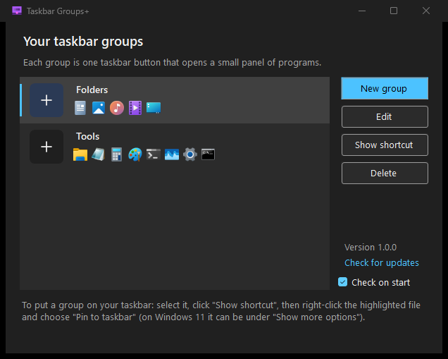
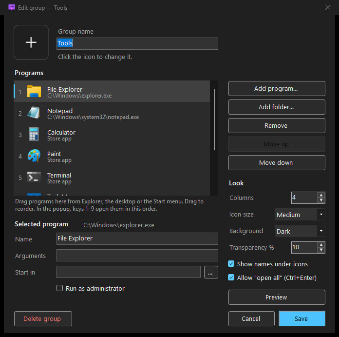

# Taskbar Groups+

**Put several programs behind one taskbar button.** Click the button and a small panel pops
up with your programs. Click one to open it.


Taskbar Groups+ is a rewritten, maintained fork of
[tjackenpacken/taskbar-groups](https://github.com/tjackenpacken/taskbar-groups), which stopped
being updated in 2021. It runs on Windows 10 and 11, is about 700 KB, needs no admin rights,
and sends nothing anywhere (see [Privacy](#privacy)).

- [Install](#install)
- [Make your first group](#make-your-first-group)
- [Using the popup](#using-the-popup)
- [Updating](#updating)
- [Backing up, moving to a new PC](#backing-up-and-moving-to-a-new-pc)
- [Uninstall](#uninstall)
- [What's different from the original](#whats-different-from-the-original)
- [Troubleshooting](#troubleshooting)
- [Building from source](#building-from-source)

---

## Install

### Easiest: one command

Open **PowerShell** (press Start, type `powershell`, press Enter), paste this, and press Enter:

```powershell
irm https://raw.githubusercontent.com/winfrydd/TaskbarGroupsPlus/main/get.ps1 | iex
```

This command:

1. Checks for the free Microsoft **.NET 10 Desktop Runtime** and offers to install it if it's missing.
2. Downloads the latest release from this page.
3. Installs it to `%LOCALAPPDATA%\Programs\TaskbarGroupsPlus`. It's your own folder, so no admin rights are needed.
4. Adds **Taskbar Groups+** to the Start menu and opens it.

You can [read the script](get.ps1) first if you like. Run the same command again any time to update.

### Manual

1. Install the [.NET 10 Desktop Runtime](https://dotnet.microsoft.com/download/dotnet/10.0) (x64)
   if you don't have it. Windows will tell you if it's missing.
2. Download `TaskbarGroupsPlus-x.y.z.zip` from [Releases](https://github.com/winfrydd/TaskbarGroupsPlus/releases/latest).
3. Unzip it into a folder you'll **keep**, for example `C:\Tools\TaskbarGroupsPlus`.
   Avoid `Program Files`, because the app saves your groups next to itself.
4. Run `TaskbarGroups.exe`.

> **Pick the folder before you pin anything.** Taskbar buttons point to the program's location.
> If you move the folder later, click **Show shortcut** for each group and pin it again.

The first time you run a downloaded copy, Windows may show **"Windows protected your PC"**.
That's because the app isn't code-signed (signing costs money every year). Click
**More info → Run anyway**.

---

## Make your first group



1. Open **Taskbar Groups+** and click **New group**.
2. Give it a name. Click the icon tile to pick an icon, or keep the plain **+**.
3. Add programs: click **Add program…** or **Add folder…**, or drag things straight in from
   Explorer, the desktop or the **Start menu**. Store apps work too.
4. Click **Save**. When it asks, click **Yes** to show the shortcut.
5. In the Explorer window that opens, right-click the highlighted shortcut and choose
   **Pin to taskbar**. On Windows 11 it may be under **Show more options**.

That's it: the new button on your taskbar opens your group.



### Options for each group

| Setting | What it does |
|---|---|
| **Columns** | How many icons per row |
| **Icon size** | Small, Medium or Large |
| **Background** | Dark, Light, or any colour you pick |
| **Transparency** | See-through background, 0–90 % |
| **Show names under icons** | Labels under each icon |
| **Allow "open all"** | Lets Ctrl+Enter open every program in the group at once |
| **Preview** | Shows the popup as it will look, without saving |

### Options for each program

Select a program in the list to change:

- **Name**: the label and tooltip shown in the popup.
- **Arguments**: extra command-line options (for example a file to open).
- **Start in**: the working folder.
- **Run as administrator**: always ask for admin rights when opening it.

Drag programs up and down to reorder them. The order is also the number keys in the popup.

---

## Using the popup

| Do this | To |
|---|---|
| Click | Open the program and close the panel |
| Ctrl+click or middle-click | Open it and keep the panel open (to open several) |
| Right-click | Open, Run as administrator, Open file location, Edit group |
| `1`–`9`, `0` | Open the program in that position |
| Arrow keys or Tab, then Enter | Pick one and open it |
| Ctrl+Enter | Open all (if allowed for the group) |
| Esc, or click anywhere else | Close |

Hover over an icon to see its name. Programs that no longer exist show a red **?** instead of
failing silently.

---

## Updating

Nothing ever updates by itself. You decide. The first time you open the app, it asks whether
it may check for new versions. If you say no, it never goes online.

- When a new version is out, an **Update to x.y.z** button appears in the main window.
  Click it to choose **Install now**, **Skip this version** (hides it until a newer one
  comes out) or **Not now**.
- Untick **Check on start** to stop looking for updates entirely. You can still click
  **Check for updates** whenever you want.
- Or run the install command again.

Installing an update only replaces the program files. Your groups, icons and taskbar pins
stay as they are. If you never update, everything keeps working as it is.

---

## Backing up and moving to a new PC

Everything lives in the program folder:

```
TaskbarGroupsPlus\
  TaskbarGroups.exe, TaskbarGroups.dll, ...   the program
  config\       your groups (one folder per group: settings, icon, icon cache)
  Shortcuts\    the shortcuts you pin to the taskbar
```

To back up, copy the **`config`** folder somewhere safe.

To move to a new PC:

1. Install Taskbar Groups+ on the new PC.
2. Copy your `config` folder into the new program folder.
3. Open the app, click **Show shortcut** for each group, and pin it.

Programs at different paths on the new PC show a red **?**. Edit the group and re-add them.

---

## Uninstall

1. Unpin the group buttons (right-click each one → **Unpin from taskbar**).
2. If you used the install command, run:
   ```powershell
   & ([scriptblock]::Create((irm https://raw.githubusercontent.com/winfrydd/TaskbarGroupsPlus/main/get.ps1))) -Uninstall
   ```
   Otherwise just delete the program folder.

Nothing is left in the registry.

---

## Privacy

- No telemetry, no accounts, no ads.
- The only network request it can make is the update check, and only if you allow it on
  first start. When you open the main window, it asks `api.github.com` for the latest release
  of this project. Untick **Check on start** to turn that off. The popup never goes online.
- Your groups stay on your PC in the `config` folder. They are not part of this repository.

---

## What's different from the original

Taskbar Groups+ is a ground-up rewrite on .NET 10. It reads the original's group format, so
you can copy your old `config` folder in, or install it over the old folder, and your groups
and pins keep working.

**Bugs fixed**

- The icon cache never got built when saving (a loop condition was wrong). Folder icons were
  saved as `.png` but looked for as `.jpg`, so icons were re-extracted on every click.
- Two programs with the same file name (two different `launcher.exe`s) overwrote each other's icons.
- With several monitors, the popup could open using the wrong monitor's taskbar.
- Some custom background colours crashed the popup.
- The "you must choose an icon" check never ran.
- Every click wrote and deleted a test file in the program folder. If that failed, it
  started a second, elevated copy of itself.
- The editor froze while it checked GitHub for a new version, every time it opened.

**New**

- Sharp icons at any screen scaling, without shortcut arrows. Store apps, folders and documents all work.
- Rounded Windows 11 style popup that opens right above the button (taskbar on any edge, auto-hide too).
- Keyboard control, right-click menu, Ctrl/middle-click to open several programs.
- Names under icons, three icon sizes, light/dark/custom background, live preview.
- Per-program **Run as administrator**, arguments and start folder.
- Drag to reorder; drag in from Explorer, the desktop or the Start menu.
- Renaming a group moves it properly. Deleting sends it to the Recycle Bin.
- Missing programs are marked instead of crashing. Errors go to `error.log`.
- Optional one-click updates (skip a version or turn checking off), a one-line installer,
  and a Start menu entry.
- No third-party libraries: two program files instead of a dozen, including a 3 MB `Windows.winmd`.

**Speed:** a popup opens in about 135 ms from click to visible on a typical PC, a little
faster than the original. The first click after a while is about twice as fast as before.

### Coming from the original Taskbar Groups

Either:

- **Keep your pins:** close the old app and copy the files from the release zip *over* your
  old folder. Old leftover files (`Windows.winmd`, `*.WindowsAPICodePack*.dll`,
  `ChinhDo.*.dll`, `JITComp`) can be deleted.
- **Fresh folder:** install Taskbar Groups+ normally, copy your old `config` folder into it,
  then use **Show shortcut** to pin each group again.

---

## Troubleshooting

| Problem | Fix |
|---|---|
| "You must install .NET to run this application" | Install the [.NET 10 Desktop Runtime](https://dotnet.microsoft.com/download/dotnet/10.0) (x64). |
| "Windows protected your PC" | The app isn't code-signed. Click **More info → Run anyway**. |
| "Isn't allowed to write to…" | The folder is read-only (for example inside Program Files). Move the whole folder somewhere you own. |
| A taskbar button says the group doesn't exist | The group was renamed or deleted. Unpin the button and pin the new shortcut. |
| A button stopped working after moving the folder | Open the app, **Show shortcut**, pin it again. |
| The popup appears as a separate taskbar button | Unpin, then re-pin the shortcut from **Show shortcut**. The shortcut carries the ID that joins them. |
| Something crashed | Look in `error.log` in the program folder, and [open an issue](https://github.com/winfrydd/TaskbarGroupsPlus/issues) with it. |

---

## Building from source

You need the [.NET 10 SDK](https://dotnet.microsoft.com/download/dotnet/10.0).

```powershell
git clone https://github.com/winfrydd/TaskbarGroupsPlus
cd TaskbarGroupsPlus
dotnet publish src/TaskbarGroups -c Release -o publish
```

`install.ps1` builds and installs over an existing folder. It backs up the folder first and
keeps `config\` and `Shortcuts\`:

```powershell
powershell -ExecutionPolicy Bypass -File install.ps1 -Target C:\Tools\TaskbarGroupsPlus
```

**Making a release:** add notes in `docs/release-notes/vX.Y.Z.md`, then push a tag:

```powershell
git tag v1.1.0
git push origin v1.1.0
```

GitHub Actions builds the zip and publishes the release. Every installed copy then offers the update.

---

## Credits and license

[MIT License](LICENSE).

- Original Taskbar Groups © 2020 Jack Schierbeck ([tjackenpacken](https://github.com/tjackenpacken)).
- Taskbar Groups+ rewrite © 2026 [winfrydd](https://github.com/winfrydd).
