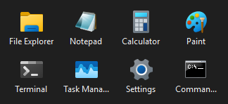

# Taskbar Groups+

Put several programs behind one taskbar button. Click it, pick a program.



A rewrite of [tjackenpacken/taskbar-groups](https://github.com/tjackenpacken/taskbar-groups),
which stopped being updated in 2021. Windows 10 and 11, about 700 KB, no admin rights,
no telemetry.

## Install

In PowerShell:

```powershell
irm https://raw.githubusercontent.com/winfrydd/TaskbarGroupsPlus/main/get.ps1 | iex
```

This installs it to `%LOCALAPPDATA%\Programs\TaskbarGroupsPlus`, adds a Start menu entry,
and offers to install the [.NET 10 Desktop Runtime](https://dotnet.microsoft.com/download/dotnet/10.0)
if it's missing. ([Read the script](get.ps1).)

Or download the zip from [Releases](https://github.com/winfrydd/TaskbarGroupsPlus/releases/latest)
and unzip it into a folder you'll keep (not Program Files). If Windows says "Windows protected
your PC", click More info → Run anyway. The app isn't code-signed.

## Use


1. Click **New group**, name it, and add programs. You can drag them in from Explorer or the Start menu.
2. Click **Save**, then **Show shortcut**.
3. Right-click the shortcut → **Pin to taskbar**.

Pin after you've chosen the install folder: moving the folder breaks the pins.


In the popup:

| Key | Action |
|---|---|
| Click | Open |
| Ctrl+click / middle-click | Open, keep the panel open |
| Right-click | Run as admin, file location, edit group |
| `1`–`9`, arrows, Enter | Open with the keyboard |
| Ctrl+Enter | Open all (if enabled) |
| Esc | Close |

## Updates

Optional. On first start it asks whether it may check GitHub for new versions. When one is
out, an **Update** button appears: install it, skip that version, or ignore it. Your groups
and pins are kept. That check is the app's only network request.

## Backup and new PC

Your groups are in the `config` folder next to the program. Copy it to back up. On a new PC,
install, copy `config` back in, and pin each group again with **Show shortcut**.

To uninstall, unpin the buttons and delete the folder.

## What's new compared with the original

- Rewritten on .NET 10. It reads the original's groups, so old configs and pins keep working.
- Sharp icons at any scaling. Store apps, folders and documents work.
- Rounded Windows 11 popup, keyboard control, right-click menu.
- Names under icons, icon sizes, custom colours, live preview.
- Per-program Run as administrator, arguments and start folder.
- Drag to reorder. Missing programs are marked instead of crashing.
- Fixed bugs: the icon cache was never built, icons collided, the popup used the wrong
  monitor, some colours crashed it, and the editor froze on a version check.
- No third-party libraries. The popup opens in about 135 ms.

## Build

```powershell
dotnet publish src/TaskbarGroups -c Release -o publish
```

Needs the .NET 10 SDK. To release, add `docs/release-notes/vX.Y.Z.md` and push a `vX.Y.Z` tag.
GitHub Actions builds and publishes it.

## License

MIT. Original © 2020 Jack Schierbeck, rewrite © 2026 [winfrydd](https://github.com/winfrydd).
